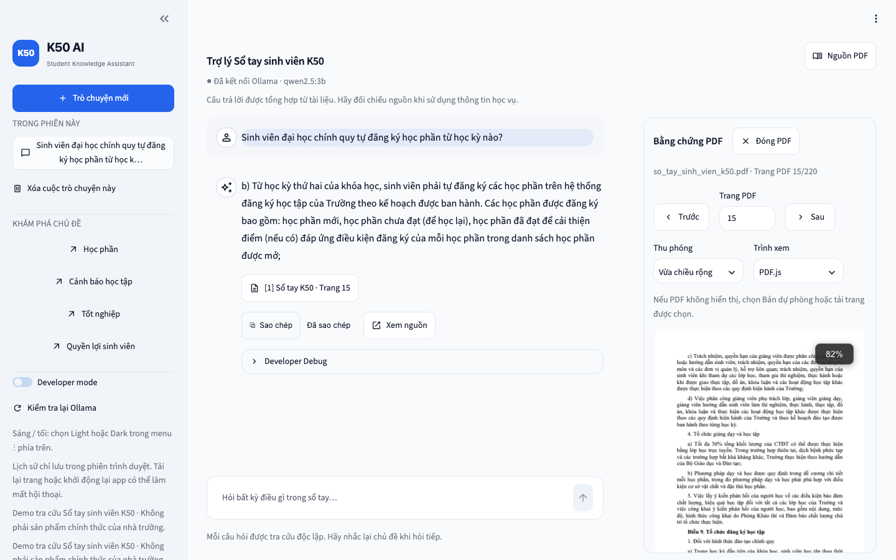

# K50 AI — Hỏi đáp Sổ tay sinh viên

Ứng dụng giúp bạn đặt câu hỏi bằng tiếng Việt về **Sổ tay sinh viên Khóa 50, Trường Đại học Sư phạm TP. Hồ Chí Minh**. Hệ thống tìm thông tin trong PDF 220 trang, tạo câu trả lời và cho phép mở trang nguồn để đối chiếu.

Đây là **bản demo**, không phải sản phẩm chính thức của nhà trường. Câu trả lời có thể sai hoặc thiếu ý; hãy kiểm tra nguồn trước khi dùng thông tin học vụ.



## 1. Cần chuẩn bị gì?

- **Python 3.11 trở lên**, Git và ứng dụng **Ollama**.
- Máy đã kiểm thử: MacBook Air M5, RAM 16GB.
- Internet khi cài thư viện và tải model lần đầu. Sau khi tải xong, câu hỏi được xử lý cục bộ, không cần API key.

Các lệnh dưới đây chạy trong **thư mục gốc dự án**, nơi có `README.md`, `requirements.txt` và `streamlit_qa_app.py`.

## 2. Cài đặt lần đầu trên macOS

Nếu đã có thư mục dự án trên máy, bỏ qua bước clone. Nếu tải mới, dùng đúng nhánh giao diện hiện tại:

```bash
git clone --branch feature/streamlit-modern-research-workbench https://github.com/vanminh92/rag-module.git
cd rag-module
```

Tạo môi trường Python riêng và cài các thành phần cần thiết:

```bash
python3.11 -m venv .venv
.venv/bin/python -m pip install -r requirements.txt

# Model tạo câu trả lời
ollama pull qwen2.5:3b

# Chuẩn bị model kiểm tra bằng chứng cục bộ
.venv/bin/python -m src.entailment --download
```

Việc tải model có thể mất vài phút. Nếu đã có `.venv` và model trên máy này, không cần tạo/tải lại. PDF và index đã có trong `data/`, nên **không cần build lại index để sử dụng**.

## 3. Mỗi lần sử dụng

Mở Terminal tại thư mục dự án, rồi chạy:

```bash
open -a Ollama
.venv/bin/python -m streamlit run streamlit_qa_app.py
```

Mở địa chỉ Streamlit in ra, thường là **http://localhost:8501**. Giữ Terminal và Ollama chạy khi dùng; nhấn **Ctrl+C** trong Terminal để dừng ứng dụng.

<details>
<summary>Cài và chạy trên Windows — PowerShell</summary>

Mở Ollama bằng ứng dụng, rồi chạy tại thư mục dự án:

```powershell
py -3.11 -m venv .venv
.\.venv\Scripts\python.exe -m pip install -r requirements.txt
ollama pull qwen2.5:3b
.\.venv\Scripts\python.exe -m src.entailment --download
.\.venv\Scripts\python.exe -m streamlit run streamlit_qa_app.py
```

Các lần sau chỉ cần mở Ollama và chạy dòng cuối. Không copy `.venv` từ macOS sang Windows; tạo môi trường mới trên máy nhận. Giao diện hiện được kiểm thử trực tiếp trên macOS/Edge.

</details>

## 4. Dùng ứng dụng như thế nào?

1. Nhập câu hỏi vào ô chat hoặc nhấn một câu gợi ý. Ví dụ: **“Sinh viên đại học chính quy tự đăng ký học phần từ học kỳ nào?”**
2. Đọc câu trả lời. Nếu chỉ tìm được một phần bằng chứng, UI hiển thị cảnh báo và phần chưa xác minh.
3. Nhấn **`[1] Sổ tay K50 · Trang …`** để xem PDF và đoạn văn bản làm nguồn. Số trang là vị trí vật lý trong PDF, bắt đầu từ 1.
4. Dùng **Trước/Sau**, nhập số trang hoặc chọn zoom để đọc. Nếu viewer lỗi, chọn **Bản dự phòng** hoặc tải trang PDF.
5. Dùng **Trò chuyện mới** và danh sách bên trái để đổi cuộc trò chuyện. Đổi sáng/tối qua menu **⋮ → Light / Dark**.

Trên mobile, PDF mở trong màn hình riêng có nút **Quay lại hội thoại**. Các thao tác xem nguồn, chuyển trang, đổi theme hoặc đổi chat không gửi lại câu hỏi tới model.

**Lưu ý:** Lịch sử chỉ lưu trong phiên trình duyệt và có thể mất khi refresh/restart. Mỗi câu hỏi được tra cứu độc lập; khi hỏi tiếp, hãy nhắc lại chủ đề. Một phản hồi có thể mất hàng chục giây, nhất là lần đầu nạp model.

## 5. Khi gặp lỗi

| Hiện tượng | Cách xử lý |
|---|---|
| Không có lệnh `python3.11` | Kiểm tra `python3 --version`; nếu từ 3.11 trở lên, dùng `python3` để tạo `.venv`. |
| Không thấy `.venv/bin/python` | Chạy bước tạo môi trường ở mục 2 trong đúng thư mục dự án. |
| Báo thiếu thư viện | Chạy lại `.venv/bin/python -m pip install -r requirements.txt`. |
| Không kết nối được Ollama | Mở ứng dụng Ollama; nhấn **Kiểm tra lại Ollama** trong sidebar. |
| Chưa có Qwen | Chạy `ollama pull qwen2.5:3b`. |
| Thiếu model kiểm chứng NLI | Chạy `.venv/bin/python -m src.entailment --download`. |
| Thiếu/hỏng index hoặc PDF | Kiểm tra `data/so_tay_sinh_vien_k50.pdf` và các file trong `data/processed/`; xem [hướng dẫn phát triển](docs/development.md). |
| PDF không hiện | Chọn **Bản dự phòng**, **Chỉ văn bản** hoặc **Tải trang này**. |
| Cổng 8501 đang dùng | Mở địa chỉ thực tế Terminal in ra, hoặc thêm `--server.port 8502` vào lệnh chạy Streamlit. |

Đừng sửa PDF, đổi embedding hay xóa index để xử lý lỗi giao diện. Ứng dụng không tự build lại dữ liệu khi mở chat.

## 6. Bên trong hệ thống

```text
Câu hỏi → Tìm đoạn liên quan trong PDF → Qwen tạo câu trả lời
        → Kiểm tra bằng chứng → Hiển thị câu trả lời và trang nguồn
```

- **RAG** là cách trả lời dựa trên tài liệu tìm được thay vì chỉ dựa vào kiến thức model.
- **Index** là dữ liệu đã chuẩn bị để tìm kiếm nhanh; dự án dùng E5 kết hợp BM25.
- **Qwen2.5 3B** tạo câu trả lời qua Ollama. Model NLI hỗ trợ kiểm tra diễn giải, nhưng cũng có thể đánh giá sai.

| Thư mục/file | Dùng để làm gì? |
|---|---|
| `streamlit_qa_app.py` | Điểm khởi chạy ứng dụng. |
| `ui/` | Giao diện chat, lịch sử, trích dẫn và PDF. |
| `src/` | Đọc tài liệu, tìm kiếm, tạo và kiểm tra câu trả lời. |
| `data/` | PDF gốc và index đã chuẩn bị. |
| `tests/` | Kiểm thử tự động. |
| `evaluation/` | Bộ câu hỏi đánh giá, công cụ đo và kết quả cuối. |
| `docs/` | Hướng dẫn kỹ thuật, kết quả kiểm thử và ảnh giao diện. |

## 7. Dành cho người phát triển

```bash
# Kiểm thử thông thường; một số tests cần model sẽ được bỏ qua
.venv/bin/python -m pytest -q

# Kiểm thử đầy đủ khi model đã được tải
.venv/bin/python -m pytest -q --run-model

# Kiểm tra retrieval cũ, không cần Ollama
.venv/bin/python -m evaluation.run_evaluation --out .cache/cv14_recheck.json
```

Lượt bàn giao trước khi dọn repo: **112 tests đạt**, CV14 **3/3**, browser live **10/10**. Đây không phải bằng chứng trả lời đúng mọi câu hỏi. Trong 30 câu test có đủ thông tin, bản nâng cấp trả lời đúng và đủ **22/30**; xem chi tiết và các trường hợp lỗi trong báo cáo bên dưới.

- [Lệnh CLI, build index và cấu hình phát triển](docs/development.md)
- [Hướng dẫn UI, ảnh desktop/mobile và giới hạn](docs/ui_workbench/README.md)
- [Thiết kế pipeline RAG](docs/open_domain_rag.md)
- [API retrieval cho Code 2](docs/code2_integration.md)
- [Kết quả đánh giá chất lượng RAG](docs/upgrade_report.md)
- [Cách chạy benchmark và định nghĩa chỉ số](evaluation/README.md)
- [Những gì đã được dọn và cách khôi phục](docs/cleanup.md)
